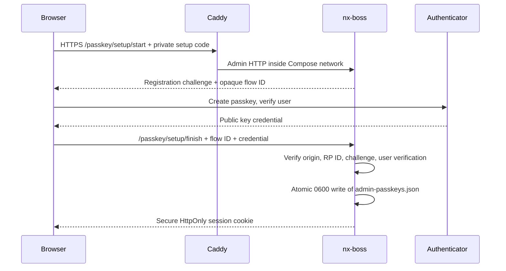

# Admin passkeys

The Admin uses one local account with WebAuthn passkeys. Password and one-time-code
login have been removed. If `config/admin-auth.json` exists, startup stops with a
clear error before creating a new setup code. A host operator must back up and
explicitly remove that obsolete file before enrolling a passkey. OIDC is deferred.

The relying party ID is exactly `NX_BOSS_ADMIN_DOMAIN`; the accepted origin is `https://<domain>` plus `NX_BOSS_ADMIN_HTTPS_PORT` when it differs from 443. The domain must resolve in the browser to Caddy and have a certificate the browser trusts. Keep the domain and port stable after enrollment. The application stores registration and authentication challenges only in memory for five minutes, with independent caps of 16 login and 16 confirmation flows. A new login replaces the oldest pending login at capacity, so anonymous requests cannot consume the confirmation pool. Login starts are limited to ten per minute per client IP (Caddy supplies X-Forwarded-For); the client table is bounded to 128 active entries. Every finish consumes its flow once, even on failure. The passkey record lives in `config/admin-passkeys.json` (0600); only public credential data and counters are persisted, never a private key. Sign-in sessions remain in memory, expire after 30 minutes idle or 12 hours total, and disappear on restart. Authentication results are persisted before a session is issued when the credential counter or backup flags change.

## Setup and daily use

1. Read `config/admin-setup-token` privately on the host. Open `https://nx.maindorfer.name/setup`, enter an Admin name, a recognizable passkey name and the code, and create a passkey using the browser's platform authenticator or security key. The code is deleted after successful registration.
2. Open `/account` and add a **second passkey on another authenticator**. Adding one first requires a fresh assertion from an existing passkey. The first authenticator is excluded from the new registration. Give it a distinct name and store the backup authenticator safely. `/account` lists all registered names. Removing a lost passkey requires a fresh assertion, revokes other sessions and pending flows, and persists before taking effect. The last key cannot be removed. Names are labels; they are not a device attestation.
3. Login uses a passkey assertion. Changing scanner credentials or the Paperless target/token requires another assertion; the confirmation is bound to the current session, valid for 60 seconds and consumed by one settings request. Same-origin HTTPS checks still apply to all writes. Logout clears the current session.

Do not forward the Admin port from the LAN to the internet. The scanner API has its own authentication and is unaffected by Admin passkeys.

## Backup and recovery

Back up `config/admin-passkeys.json` with the rest of `config/`, preserving ownership and mode. If **all** passkeys are lost, a host operator must stop nx-boss, make a private backup of that file, remove it, then restart nx-boss and enroll again with the newly generated private setup code. This destroys the old Admin identity and invalidates its sessions. Do not remove the file while the process is running; it would retain the old account in memory. An image older than the passkey feature cannot read this file, so an image rollback must keep Admin access isolated until the authentication state is deliberately restored.

The separate `secrets/auth_pepper` is still required for scanner password verification. It does not protect the passkey private key, which remains on the authenticator.

## Test gates

`cargo test --locked` covers setup-token rejection and one-use flow behavior. `tests/browser/passkey.spec.js` uses Chromium virtual authenticators over an isolated HTTPS proxy to cover first enrollment, adding another authenticator, login, challenge replay rejection, same-origin rejection, sensitive-setting confirmation and restart persistence. CI runs the browser suite. Deployment additionally needs a manual enrollment with the operator's real authenticator; automated tests cannot prove that a particular device or browser will offer its platform passkey.

## Optional: trust this device for 30 days

Only the passkey **login**, never initial setup, offers an unchecked “Trust this
device for 30 days” option and optional device name. A successful verified login
sets `__Host-nx-trust` with Secure, HttpOnly, SameSite=Strict, Path=/ and a fixed
30-day Max-Age. The 256-bit random bearer is kept only in that cookie; the private
atomic mode-0600 `config/admin-trusted-devices.json` stores SHA-256 hashes and
absolute UTC created/expiry/last-used timestamps. The fixed expiry never slides.
At most eight devices are kept; enrolling a ninth removes the oldest. Last-used
persistence happens at most once per UTC day. Include this file in private backups.

With a valid device cookie, a **GET page visit** can create a normal session after
idle expiry or restart. A POST or other mutation cannot use device trust directly.
Restored sessions have no passkey confirmation: scanner/Paperless changes, scan
recovery, passkey management and device revocation still require a fresh assertion.
Other job/retention actions keep their existing session requirements (B20).

`/account` lists name, created, expiry and last-used UTC times, marks the current
device, and offers one-device and all-device revocation with fresh passkey
confirmation. Revocation invalidates associated sessions immediately. Removing a
passkey revokes all devices; the current session survives that action because a
fresh passkey assertion was required. Logout revokes the current device, including
its session association if the browser's device cookie is already missing, and
clears both cookies. Unknown or expired device cookies are cleared.

A missing, malformed, oversized, symlinked or overly permissive device file disables
device trust and records a redacted warning; it never prevents passkey login or
service startup. A new Admin identity discards prior device trust. Failure to
persist a revocation is reported rather than presented as successful; do not
restore an old auth snapshot that would resurrect revoked devices.

**Residual risk:** anyone who has an unlocked trusted device can view scans and
change jobs and retention periods without another passkey login. Use the option
only on your own devices with a lock screen. A stolen cookie is a bearer credential
until expiry or revocation. Device names are labels, not hardware attestation.

Regression coverage: `trusted-devices.spec.js` exercises opt-in/no-cookie login,
restart recovery, POST and confirmation denial, all revocation paths, day-31 expiry,
private hash persistence and damaged-file fallback; the mobile dark-mode test
covers German and English. Store and production-router unit tests also cover the
fixed TTL, daily writes, eight-device cap and immediate session revocation.
