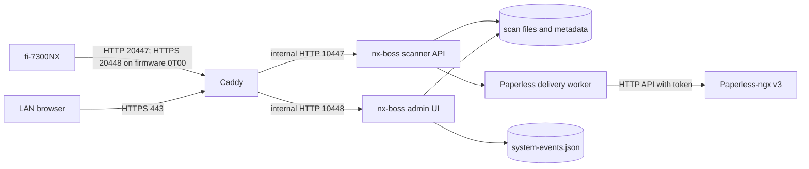
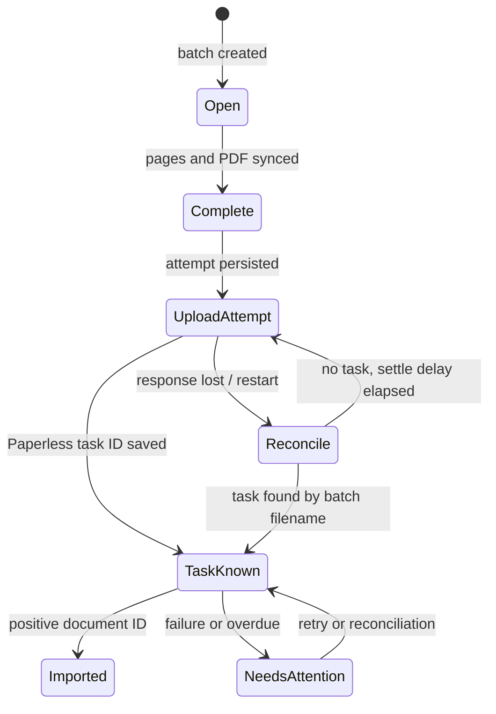

# Architecture and delivery

The Rust service publishes no host port in Compose. Caddy is the only ingress. Scanner and admin routes use separate internal listeners. The physical scanner on firmware `0T00` completed its HTTPS connection check on port 20448 with TLS 1.2 and `TLS_ECDHE_ECDSA_WITH_AES_128_GCM_SHA256`; a full scan over this path remains to be checked. Scanner HTTP remains available. The admin HTTPS certificate uses DNS-01 for `nx.maindorfer.name`.

The PDF upload is at-least-once after an uncertain response. Paperless has no documented idempotency key for this API; task lookup and duplicate detection reduce but do not eliminate duplicate risk. A batch with no confirmed document ID is retained. The dashboard counts documents and pages from completed **stored** batches, so deletion/archival changes those totals. “Imported” means a Paperless document ID was confirmed. The event browser keeps the latest 200 redacted WARN/ERROR events; container JSON logs remain the complete operational log stream.
