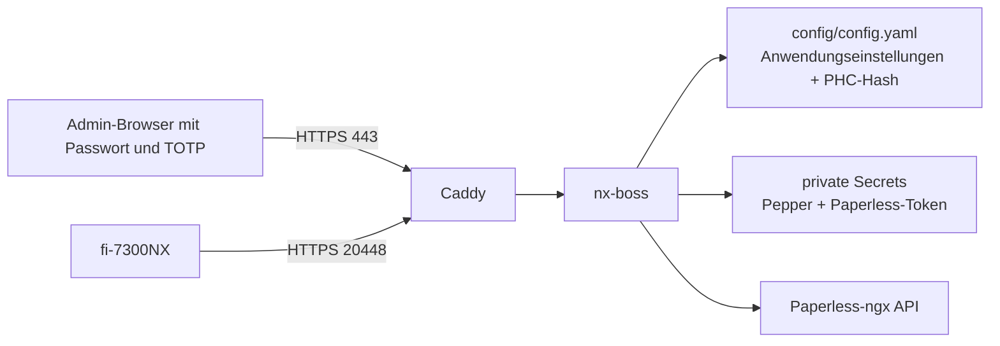

# Konfiguration über die Admin-Oberfläche: Umsetzungsentwurf

> Historischer Entwurf für die ursprüngliche Passwort/TOTP-Einführung. Neue Installationen richten seit 2026-10-01 Passkeys ein; aktueller Ablauf und Recovery stehen in [Admin passkeys](admin-passkeys.md).

Stand: 2026-09-30. Die beschriebene Oberfläche und ihre Schutzfunktionen sind lokal implementiert und getestet; der physische Scanner-Test nach dem VM-Rollout bleibt eine eigene Abnahme. Frühere Abschnitte dieses Dokuments beschreiben den Entwurf vor der Implementierung. Die aktuelle Bedienung steht im [README](../README.md).

## Ausgangslage

Auf der VM ist `config/config.yaml` die Anwendungsdatei. Jobs und Aufbewahrungsfristen lassen sich bereits im Web ändern. Sprache und Paperless-URL/-Optionen stehen ebenfalls in der Datei, sind aber nicht vollständig über die Oberfläche editierbar. Scanner-Modus und -Benutzer kommen derzeit aus `.env`, das Scanner-Passwort aus einer privaten Klartextdatei. `Config::save_with_next` schreibt die YAML-Datei bei Job- und Friständerungen neu; neue Felder müssen deshalb in **alle** Lade-/Speicherpfade aufgenommen werden. Die Admin-Oberfläche hat noch keinen Login. Diese Grenze muss geschlossen werden, bevor sie Scanner-Zugangsdaten oder Paperless-Secrets verwaltet.

## Ziel und Grenze

Alle **Anwendungseinstellungen** sollen im Web bearbeitbar sein: Jobs einschließlich Reihenfolge und Scan-Parametern, Aufbewahrung, Standardsprache, Paperless-Ziel/Tags/Custom-Field, Scanner-Anmeldemodus und Benutzername sowie Passwortwechsel. Für Scanner-Parameter, die das einfache Jobformular noch nicht abbildet, braucht es einen validierten Expertenbereich; sonst würde ein Speichern vorhandene `job_settings`/`scan_settings` verlieren. Der aktuelle Wert eines Passworts oder API-Tokens wird niemals angezeigt. Interne Zähler wie `next_job_id` bleiben automatisch verwaltet. Den früher aus dem Jobformular entfernten Ausgabepfad behandeln wir als internen Speicherort, nicht wieder als frei editierbare Job-Option.

Container- und Netzwerk-Einstellungen (`443`, `20447`, `20448`, Bind-IPs, Caddy-DNS, UID/GID, Volume-Pfade) bleiben in Compose/`.env`: der laufende Prozess kann seine veröffentlichten Ports oder Docker-Mounts nicht sicher selbst ändern. Pepper und Paperless-API-Token sind Secrets, keine YAML-Werte. Die Oberfläche kann einen Paperless-Token **ersetzen**, schreibt ihn aber in eine private Secret-Datei und zeigt ihn danach nicht wieder an.



## Scanner-Passwort

Vorgeschlagene YAML-Struktur:

```yaml
scanner_auth:
  mode: userpass # oder none
  username: scanner-user
  password_hash: '$argon2id$v=19$m=...$...$...'
```

`password_hash` ist ein PHC-String mit **Argon2id**, individuellen zufälligen Salt und festgelegten Parametern. Der Pepper wird **nicht** in YAML, `.env` oder demselben Backup wie die YAML gespeichert. Er liegt als eigene private Docker-Secret-Datei außerhalb des Image und wird beim Start gelesen. RustCrypto Argon2 unterstützt dafür `new_with_secret`; bei falschem oder fehlendem Pepper schlägt `userpass` geschlossen fehl. Der Pepper muss separat gesichert werden: Geht er verloren, sind die gespeicherten Hashes nicht mehr verifizierbar und die Scanner-Passwörter müssen neu gesetzt werden. Rotieren des Peppers erfordert Re-Hash beim nächsten bekannten Passwort oder einen gezielten Passwortwechsel.

Die Web-Maske nimmt ein neues Passwort einmalig über Admin-HTTPS an, hasht es serverseitig und speichert nur den PHC-String. Sie zeigt lediglich „Passwort gesetzt“ an. Die bisherige Klartextdatei wird erst entfernt, nachdem Migration, Neustart und Anmeldung am physischen Scanner erfolgreich sind. Umschalten des Modus oder Ändern von Benutzer/Hash widerruft alle Scanner-Bearer; der Scanner muss sich neu anmelden. `none` darf keine versehentliche Passwortausgabe erzeugen.

## Admin-Zugriff und Laufzeitänderungen

Vor dem neuen Konfigurationsformular: ein lokaler Admin mit Passwort **und TOTP**, wie bereits entschieden. Die Umsetzung verwendet Secure-/HttpOnly-/SameSite-Cookies, gleiche HTTPS-Origin für Schreibzugriffe, Sitzungsablauf und Rate Limit. Die einmalige Einrichtung verlangt ein privates Setup-Token aus dem Dateisystem. Der TOTP-Secret liegt in `config/admin-auth.json` mit Dateimodus 0600; Passwort und Scanner-Passwort werden nur als Argon2id-Hash gespeichert. Beim Geräteverlust kann nur ein Betreiber mit Zugriff auf das private Dateisystem nach Stop/Backup/Entfernen dieser Datei neu einrichten. Einmalige Recovery-Codes sind derzeit nicht implementiert. Der Admin-Login schützt auch `/scans` und Dateien.

Für jede Änderung: vollständigen Kandidaten validieren, betroffene Secrets zuerst atomar in private Dateien schreiben, YAML atomar mit `fsync` ersetzen, danach den gemeinsamen Laufzeit-Snapshot austauschen und ein redigiertes Audit-Ereignis ohne Secret-Werte schreiben. Bei Validierungs- oder Schreibfehler bleibt der bisherige Laufzeitstand aktiv. Scanner-Requests übernehmen einen konsistenten Snapshot und halten keine Konfigurationssperre während Scan-I/O oder Argon2-Arbeit. Teure Passwortprüfung läuft begrenzt in einem Blocking-Pool, damit sie den HTTP-Server nicht blockiert.

Der Paperless-Client ist derzeit beim Start erzeugt und an den Worker geklont. Für Web-Änderungen muss er live austauschbar werden. Tokenwechsel dürfen laufende Uploads nicht unterbrechen; ein Upload verwendet den beim Start dieses Versuchs übernommenen Client. Das Paperless-**Ziel** darf bei offenen oder unklaren Uploads nicht stillschweigend umgeschaltet werden, weil ein Retry sonst an ein anderes System gehen könnte. Die UI zeigt die Sperre und den Grund an. Tag-/Feldoptionen gelten für neu angelegte Batches; vorhandene Batches behalten ihren gespeicherten Snapshot.

## TDD- und Abnahmekriterien

1. Parser-/Migrations-Tests: bestehende YAML bleibt lesbar; Job-/Friständerungen erhalten Scanner- und Paperless-Felder; ungültige Kombinationen starten nicht stillschweigend in `none`.
2. Passwort-Tests: Hash enthält nie Klartext oder Pepper, unterschiedliche Salts, richtige/falsche Verifikation, fehlender/falscher Pepper, private Dateirechte; keine Secret-Werte in Logs, HTML oder Fehlermeldungen.
3. Zustands-/Nebenläufigkeitstests: fehlgeschlagene Speicherung verändert nichts; Modus- oder Passwortwechsel widerruft Bearer; parallele Scanner-Requests sehen einen vollständigen alten oder neuen Snapshot; kein Deadlock mit Jobänderungen.
4. Admin-Tests: alle Admin-Routen verlangen Login/TOTP; Session-/CSRF-/Logout-/Rate-Limit-Verhalten; Playwright für Passwortwechsel und Moduswechsel in Deutsch und Englisch.
5. Paperless-Tests: Tokenrotation bei laufendem Upload; URL-Änderung bei offener/unklarer Zustellung blockiert; bestehende Batches behalten Optionen. CI prüft Übersetzungsvollständigkeit und das Browser-Verhalten.
6. Rollout: private Backups von YAML, `.env` und Secret-Dateien; Migration der vorhandenen Testdaten ohne Ausgabe; Caddy/App-Smoke; danach physische Scanner-Anmeldung und unkritischer Scan. Paperless selbst wird nicht verändert.

Quellen für die Hash-Entscheidung: [OWASP Password Storage Cheat Sheet](https://cheatsheetseries.owasp.org/cheatsheets/Password_Storage_Cheat_Sheet.html), [RustCrypto Argon2 API](https://docs.rs/argon2/latest/argon2/).

## Umgesetzte Bedienung und Grenzen

- `/setup` richtet mit dem privaten `config/admin-setup-token` einen Admin ein. Passwort und TOTP sind danach Pflicht. `/account` ändert Benutzername/Passwort oder rotiert TOTP, jeweils mit erneutem Passwort und frischem Code. Ein erfolgreicher Wechsel widerruft bisherige Admin-Sitzungen. Bei Verlust des TOTP-Geräts ist nur eine Wiederherstellung mit Dateisystemzugriff möglich: App stoppen, `config/admin-auth.json` privat sichern und entfernen, neu starten, mit neuem Einmalcode einrichten. Recovery-Codes gibt es noch nicht.
- `/settings/scanner` ändert Modus, Benutzername und Passwort. Ein gesetztes Scanner-Passwort erscheint nicht im HTML oder YAML. Der Hash ist Argon2id mit individuellem Salt und privatem Pepper aus `secrets/auth_pepper`; ein Wechsel widerruft bestehende Scanner-Bearer. Der einmalige CLI-Aufruf `--migrate-scanner-auth` liest die Legacy-Umgebungswerte und Passwortdatei und schreibt nur den Hash in YAML. Die alte Datei bleibt für einen geprüften Rollback erhalten.
- `/settings/paperless` ändert URL, Tags, Batch-ID-Feld und Token. Ein neuer Token wird in eine neue private Datei `config/paperless-token-*` geschrieben. Das Paperless-Ziel lässt sich bei laufenden Scanner-Batches oder offenen Paperless-Zustellungen nicht wechseln. Ein laufender Upload verwendet den beim Start übernommenen Client; der Worker übernimmt anschließend den neuen Stand.
- `/settings/language` ändert die Standardsprache für Browser ohne Sprach-Cookie. `/jobs/{id}/expert` stellt die in der einfachen Maske fehlenden `job_settings`- und `scan_settings`-JSON-Felder bereit. Ports, Bind-Adressen, Caddy-DNS, Container-UID/GID und Volume-Pfade bleiben in Compose/`.env`; `output_path` bleibt eine interne Storage-Einstellung.
- Ein neues Admin-Konto braucht einen manuellen Setup-Schritt. Bis dahin leitet die Admin-Oberfläche zur Einrichtung um; Scanner und Paperless-Worker laufen unabhängig davon. Physischer Login und Scan am fi-7300NX mit dem neuen Hash sind nach dem Rollout separat zu prüfen.
